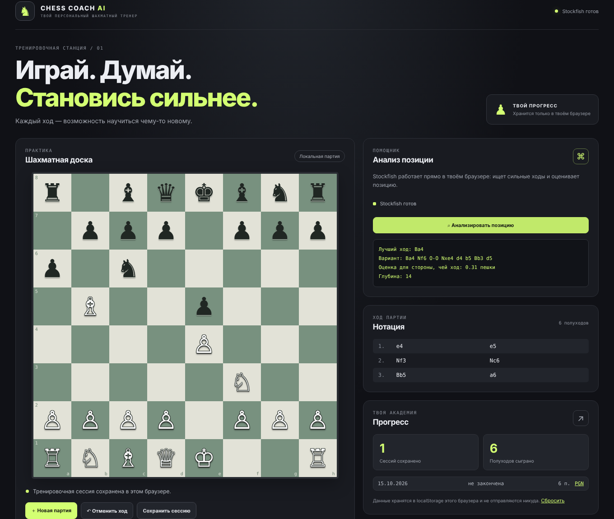

# Chess Coach AI

**Шахматный тренер, который целиком работает в браузере.** Интерактивная доска, анализ позиций движком Stockfish (WebAssembly) и прогресс тренировок. Ни сервера, ни регистрации, ни установки Python: сайт — это статические файлы, которые можно хостить бесплатно на GitHub Pages.

[English version](README.md)



## Возможности

- Доска с подсветкой легальных ходов, превращением пешки (выбор фигуры), отменой хода и нотацией.
- Анализ позиции Stockfish 19 прямо в браузере: лучший ход, основной вариант в обычной нотации (SAN), оценка или мат. Результат обновляется по мере роста глубины.
- Сохранение тренировочных сессий в `localStorage`, счётчики прогресса, скачивание партий в PGN.
- Данные не покидают устройство: никаких аккаунтов, аналитики и запросов на сторонние серверы (кроме шрифтов Google Fonts).
- Работает на телефоне и на любом статическом хостинге.

## Быстрый старт

Нужен [Node.js](https://nodejs.org/) 20 или новее.

```bash
git clone https://github.com/bav010/chess_trainer_ai.git
cd  chess_trainer_ai
npm install
npm run dev
```

Откройте адрес, который покажет Vite (обычно http://localhost:5173).

**Windows:** можно просто дважды кликнуть `start_chess_coach.bat` — он сам установит пакеты и откроет сайт.

| Команда | Что делает |
| --- | --- |
| `npm run dev` | сервер разработки с горячей перезагрузкой |
| `npm run build` | проверка типов и сборка в папку `dist/` |
| `npm run preview` | запуск собранного сайта локально |
| `npm run typecheck` | только проверка TypeScript |

> Собранный `dist/index.html` нельзя открыть двойным кликом (`file://`): браузеры не запускают WebAssembly-движок с локального файла. Используйте `npm run preview` или любой статический сервер.

## Как это устроено

```
src/
  App.tsx        интерфейс: доска, анализ, нотация, прогресс
  engine.ts      обёртка над Stockfish: Web Worker + протокол UCI
  storage.ts     сессии в localStorage
  main.tsx       точка входа React
  style.css      стили
public/engine/   Stockfish.js 19 (lite, однопоточный): .js, .wasm и лицензия
.github/workflows/pages.yml   сборка и публикация на GitHub Pages
```

- **Шахматная логика** (правила, легальные ходы, PGN) — библиотека [chess.js](https://github.com/jhlywa/chess.js).
- **Движок.** Используется сборка `lite-single`: около 1,9 МБ, без многопоточности, поэтому не требует заголовков `COOP/COEP`, которые GitHub Pages не позволяет задавать. Она слабее полной версии, но заметно сильнее любого человека. `engine.ts` запускает её в Web Worker и общается по UCI.
- **Настройка анализа.** Глубина и лимит времени заданы в вызове `engine.analyse(...)` в `App.tsx` (по умолчанию глубина 14 и до 4 секунд).
- **Хранение.** `storage.ts` пишет в `localStorage` ключ `chess-coach-ai:sessions:v1` (до 200 последних сессий). Данные остаются в браузере пользователя.

## Планы

- Игра против Stockfish с выбором уровня силы.
- Тактические задачи (открытая база Lichess, CC0).
- Тренажёр дебютов с повторением по интервалам.
- Импорт PGN и разбор партий: график оценки, классификация ошибок.
- Эндшпильные тренажёры, мобильное управление перетаскиванием, тёмная и светлая темы.

Идеи и баги приветствуются в Issues.

## Участие в разработке

Форки и pull request'ы приветствуются. Перед отправкой запустите `npm run build` — он проверяет типы и собирает сайт; ту же проверку делает CI. Подробнее: [CONTRIBUTING.md](CONTRIBUTING.md).

## Лицензия и благодарности

Проект распространяется под **GNU GPL v3 или новее** — см. [LICENSE](LICENSE). Причина: в репозиторий входит движок Stockfish (GPLv3), поэтому весь проект распространяется на тех же условиях. Вы можете использовать, изменять и публиковать код, сохраняя эту лицензию и открытые исходники.

Использованные проекты:

- [Stockfish](https://github.com/official-stockfish/Stockfish) — шахматный движок, GPLv3.
- [Stockfish.js](https://github.com/nmrugg/stockfish.js) (Nathan Rugg, Chess.com) — сборка Stockfish для WebAssembly, GPLv3. Версия 19.0.1, файлы лежат в `public/engine/`.
- [chess.js](https://github.com/jhlywa/chess.js) — правила шахмат, BSD-2-Clause.
- [React](https://react.dev/) и [Vite](https://vite.dev/) — MIT.
